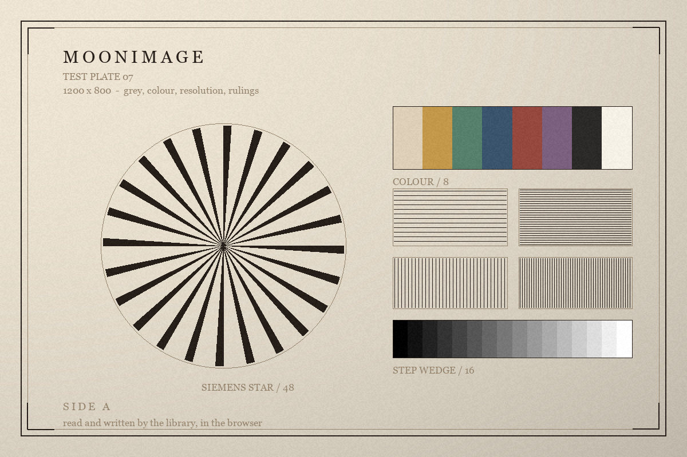

# moonimage

Image codecs for MoonBit: sixteen formats read, fifteen written, and the pixel
arithmetic that sits between them.

<p>
  <a href="https://moonbitstack.github.io/moonimage/"><b>Homepage</b></a> &nbsp;·&nbsp;
  <a href="https://moonbitstack.github.io/moonimage/guide.html">Guide</a> &nbsp;·&nbsp;
  <a href="https://moonbitstack.github.io/moonimage/showcase.html">Workbench</a> &nbsp;·&nbsp;
  <a href="https://moonbitstack.github.io/moonimage/api.html">API</a> &nbsp;·&nbsp;
  <a href="https://mooncakes.io/docs/#/moonbitstack/moonimage/">mooncakes</a>
</p>

No I/O, all four backends, and two dependencies: the deflate stream a PNG needs
and the colour package a hue rotation needs. Nothing here imports
`moonbitlang/x`; the only place in this repository that does is the conformance
harness, which lives in a module of its own under `integration/` because a file
system belongs beside the check rather than in the library.

```moonbit
test {
  let image = @moonimage.Image::new(640, 480, @moonimage.PixelFormat::Rgba8)
  let small = image.scale(160, 120, sampling=@moonimage.Sampling::Bilinear)
  let file = @moonimage.encode(small, @moonimage.Format::Png)
  let back = @moonimage.decode(file)
  assert_eq(back.width, 160)
  assert_eq(back.height, 120)
}
```

<p align="center">
  
</p>

Two runs to start from: `moon run src/examples/01-tour` walks one picture
through every format and every operation, and `moon run src/examples/02-guide`
is the program behind the [guide](https://moonbitstack.github.io/moonimage/guide.html).

## Reading and writing

`decode` reads the signature and hands the bytes to the package that knows that
format. It takes the limits a reader works under, which are checked before
anything is allocated:

```moonbit
test {
  let image = @moonimage.Image::new(8, 8, @moonimage.PixelFormat::Rgb8)
  let file = @moonimage.encode(image, @moonimage.Format::Tiff)
  let safe = @moonimage.decode(file, limits=@moonimage.Limits::strict())
  assert_eq(safe.width, 8)
}
```

A file that is damaged, truncated, or larger than the limits raises `Refused`,
which says where it stopped and what it wanted:

```moonbit
test {
  let refused = try {
    ignore(@moonimage.decode(b"not an image"))
    abort("unreachable")
  } catch {
    error => error
  }
  assert_eq(refused is @moonimage.Refused::Unknown(_), true)
}
```

`Unexpected` and `Checksum` mean damaged bytes, `Truncated` means the file ends
early, `OverLimit` means the caller's limits refused it, `Unknown` means it is not
a format this library reads, and `Unsupported` means a part of a format it does
not implement.

`encode` writes the format the caller names, with that format's defaults. It
raises `Refused` when a format cannot hold what is asked of it — a negative
sample in an unsigned BC6H block, say. A caller that wants to choose how it is
written goes to the format's own package, which takes its options record: a
compression for OpenEXR or TIFF, a tile size for TIFF, a block format for a
texture, a quality for a lossy WebP.

| Format | Read | Write | Animation | Package |
|:--|:--:|:--:|:--:|:--|
| PNG | every colour type and depth, palette and `tRNS`, Adam7, five filters, CRC, `gAMA` `cHRM` `sRGB` `iCCP` `tEXt` `zTXt` `iTXt` | 8 and 16 bits, palette when it is smaller, adaptive filtering, interlaced on request, metadata | APNG | `@moonimage/png` |
| QOI | all six opcodes | the reference encoder's choices, byte for byte | — | `@moonimage/qoi` |
| BMP | every header version, 1/4/8/16/24/32 bits, `BI_RGB` `BI_RLE4` `BI_RLE8` `BI_BITFIELDS`, both row orders | 24 and 32 bits | — | `@moonimage/bmp` |
| TGA | colour mapped, true colour and grey, run lengths, 8/15/16/24/32 bits, both row orders | 24 and 32 bits, run lengths on request | — | `@moonimage/tga` |
| JPEG | baseline and progressive, every subsampling, greyscale, EXIF orientation | baseline, quality 1–100, three subsamplings | — | `@moonimage/jpeg` |
| GIF | palettes, transparency, interlace, run lengths | palette by exact colours or median cut, dithering | yes | `@moonimage/gif` |
| WebP | lossless (VP8L) with its four transforms, and lossy (VP8) with its boolean coder, predictors, loop filter and chroma upsampling; alpha in either; animated files | lossless by `encode`, lossy by `encode_lossy`, which takes a quality | yes | `@moonimage/webp` |
| TIFF | strips or tiles, LZW, PackBits, deflate or none, horizontal prediction, grey, grey with alpha, RGB, RGBA and palette at 1 to 16 bits, planar or chunky, every page | 8 and 16 bits, three compressions, prediction on request, several pages, tiles on request | pages | `@moonimage/tiff` |
| ICO / CUR | PNG entries and bitmap entries at 1/4/8/24/32 bits with the one-bit mask, every size in the file | PNG entries, at any list of sizes | sizes | `@moonimage/ico` |
| PNM | PBM, PGM, PPM and PAM, both spellings, any maximum | all four shapes, both spellings | — | `@moonimage/pnm` |
| Radiance HDR | RGBE, the new run-length code and the flat one, all four origins | RGBE with the run-length code | — | `@moonimage/hdr` |
| OpenEXR | scanlines or tiles, one part or several, in half or float, uncompressed, RLE, ZIPS, ZIP, PIZ, PXR24, B44, B44A, DWAA or DWAB | scanlines, all nine compressions, one part or several | — | `@moonimage/exr` |
| farbfeld | the whole format | the whole format | — | `@moonimage/farbfeld` |
| DDS | BC1 to BC7 blocks, and uncompressed surfaces | BC1 to BC7 blocks, and uncompressed surfaces | — | `@moonimage/dds` |
| PCX | 1, 2, 4 and 8 bits a pixel, one to four planes, the header palette and the one at the end, run lengths | 8 bits a plane, three planes or four, run lengths | — | `@moonimage/pcx` |
| SGI | one, three or four channels, eight or sixteen bits a sample, stored plain | eight bits a sample, three or four channels | — | `@moonimage/sgi` |
| Sun raster | 1, 8, 24 and 32 bits a pixel, a colour map of three planes, rows padded to a word, byte-encoded runs | 24 bits, or 32 with this library's alpha in the fourth byte | — | `@moonimage/ras` |

Both halves of WebP are read; the lossless one, VP8L, is also written. VP8 is the
intra frame of a video codec, so its picture is rebuilt rather than decoded: a
boolean arithmetic coder over prediction modes and transform coefficients, ten
predictors for four-by-four blocks and four for sixteen-by-sixteen ones, a
residual carried as quantised coefficients, a loop filter along every macroblock
and transform edge, and chroma interpolated between the two rows it sits between.
What comes out is the reconstruction the format defines, sample for sample — a
lossy decoder that is "nearly right" is one with a bug in it.

A lossy picture has no alpha in VP8 itself, so a transparent one carries a
separate `ALPH` chunk beside the picture. That is read too, in a still picture and
inside an animation frame, and comes back as four samples per pixel.

A TIFF is a directory of tags pointing at data anywhere in the file, and a page
of it holds either strips — rows grouped for compression — or tiles, which are
the same rows cut into rectangles. Both are read, and either can be written. An
EXR is read the same way: a part of it holds scanlines or tiles, and a file may
hold several parts, each with its own channels and its own compression.

A DDS is a block grid: four by four pixels become eight or sixteen bytes, and
what those bytes hold is a format of its own — two endpoints and an index a pixel
in BC1 to BC5, a mode number and a table of shapes in BC7, and half-precision
light in BC6H. `decode` gives the picture in the layout the block is, and `decode`
takes a format for the one a caller is drawing with, because a block layout is
rarely a display layout.

## The image

An image is a rectangle of samples, the format that says how to read them, and
the metadata that travelled with them.

<!-- nocheck -->
```moonbit
pub(all) struct Image {
  width : Int32
  height : Int32
  format : PixelFormat
  stride : Int32
  pixels : Bytes
  premultiplied : Bool
  metadata : Metadata
}
```

The row stride is separate from the width because a caller uploading to a GPU needs
rows padded to a multiple of 256 bytes. Pixels are immutable: every operation
returns a new image rather than writing into the old one.

| Pixel format | Samples | Bytes a pixel |
|:--|:--|:--|
| `Gray8`, `GrayAlpha8`, `Rgb8`, `Rgba8` | 8-bit | 1, 2, 3, 4 |
| `Gray16`, `GrayAlpha16`, `Rgb16`, `Rgba16` | 16-bit, big-endian | 2, 4, 6, 8 |
| `RgbaF32` | floats, little-endian | 16 |

## Moving pixels

Conversions widen, narrow, add or drop alpha, and turn grey into three equal
channels. Narrowing rounds rather than truncates, and colour becoming grey is a
luminance rather than one of the channels:

```moonbit
test {
  let image = @moonimage.Image::new(4, 2, @moonimage.PixelFormat::Rgba8)
  let grey = image.convert(@moonimage.PixelFormat::Gray8)
  let wide = image.convert(@moonimage.PixelFormat::Rgba16)
  assert_eq(grey.format, @moonimage.PixelFormat::Gray8)
  assert_eq(wide.format, @moonimage.PixelFormat::Rgba16)
  let flat = image.to_premultiplied()
  assert_eq(flat.premultiplied, true)
  assert_eq(flat.to_straight().premultiplied, false)
}
```

The operations that are a permutation keep the format and every sample exactly:

```moonbit
test {
  let image = @moonimage.Image::new(3, 2, @moonimage.PixelFormat::Rgba8)
  assert_eq(image.flip_horizontal().width, 3)
  assert_eq(image.flip_vertical().height, 2)
  assert_eq(image.rotate(quarters=1).width, 2)
  assert_eq(image.crop(0, 0, 2, 1).height, 1)
}
```

Scaling has five filters. Nearest is what pixel art wants, bilinear what a
photograph wants when it is scaled a little, Catmull-Rom and Lanczos what it
wants when the edge matters, and the Gaussian the one to reach for when ringing
is the problem:

```moonbit
test {
  let image = @moonimage.Image::new(9, 7, @moonimage.PixelFormat::Rgb8)
  for
    sampling in [
      @moonimage.Sampling::Nearest,
      @moonimage.Sampling::Bilinear,
      @moonimage.Sampling::CatmullRom,
      @moonimage.Sampling::Gaussian,
      @moonimage.Sampling::Lanczos,
    ] {
    assert_eq(image.scale(16, 12, sampling~).width, 16)
  }
}
```

Alpha is resampled premultiplied even when the image is not stored that way, so a
transparent pixel's colour does not bleed into its neighbours. Every filter
widens its footprint when the image is made smaller, bilinear included: what it
reaches for at a downscale is everything the output pixel stands for, which is
the whole of antialiasing.

A rotation that is not a right angle resamples, and can grow the canvas to hold
what comes out:

```moonbit
test {
  let image = @moonimage.Image::new(8, 4, @moonimage.PixelFormat::Rgba8)
  let tilted = image.rotate_by(30.0, expand=true)
  assert_eq(tilted.width > 8, true)
  assert_eq(image.rotate_by(90.0).width, 4)
}
```

## Filters and colour

Blurring is a separable Gaussian of the radius given, on premultiplied samples;
sharpening is the difference between a picture and its own blur:

```moonbit
test {
  let image = @moonimage.Image::new(6, 5, @moonimage.PixelFormat::Rgba8)
  let soft = image.blur(1.5)
  assert_eq(soft.width, 6)
  let crisp = soft.unsharp_mask(radius=1.0, amount=150.0, threshold=3)
  assert_eq(crisp.height, 5)
}
```

`kernel` chooses how the Gaussian is worked out. The default convolves with the
kernel, which is what the number means. `Boxes` does what Pillow, Skia and the
browsers do — three box passes whose widths are chosen so that their variance is
the variance asked for — which is cheaper and within a step of the kernel
everywhere, and is the one to reach for when a picture has to match one of those:

```moonbit
test {
  let image = @moonimage.Image::new(6, 5, @moonimage.PixelFormat::Rgba8)
  let same_as_pillow = image.blur(1.5, kernel=@moonimage.Kernel::Boxes)
  assert_eq(same_as_pillow.width, 6)
}
```

Brightness multiplies, contrast turns about mid-grey, the hue rotation keeps
saturation and lightness, and inverting leaves alpha alone:

```moonbit
test {
  let image = @moonimage.Image::new(3, 3, @moonimage.PixelFormat::Rgba8)
  assert_eq(image.brightness(1.5).contrast(1.2).hue_rotate(90.0).invert().width, 3)
}
```

A hue rotation is a conversion, so it goes through the colour package that owns
the spaces: a pixel becomes a `moonrgba` colour and comes back.

Compositing is source over, with the source converted to the destination's format
and its alpha scaled by the opacity asked for:

```moonbit
test {
  let under = @moonimage.Image::new(4, 4, @moonimage.PixelFormat::Rgba8)
  let over = @moonimage.Image::new(2, 2, @moonimage.PixelFormat::Rgba8)
  let drawn = under.composite(over, x=1, y=1, opacity=0.5)
  assert_eq(drawn.width, 4)
}
```

## Animation

Three formats carry frames, and they agree on the shape even where they disagree
on the arithmetic: a canvas, a rectangle per frame, a delay, a rule for what to
do with the pixels underneath, and a rule for what to leave behind.

```moonbit
test {
  let image = @moonimage.Image::new(4, 4, @moonimage.PixelFormat::Rgba8)
  let file = @moonimage.encode(image, @moonimage.Format::Gif)
  let animation = @moonimage.decode_animation(file)
  assert_eq(animation.frames.length(), 1)
  assert_eq(animation.compose().length(), 1)
}
```

`compose` applies the disposal and blending rules in order, which is what a viewer
shows. A file that does not animate comes back as one frame over the whole
canvas, and a TIFF comes back as a frame a page.

## Metadata

What a file says about itself travels with the image, and goes back out when it is
written. Nothing here is interpreted: colour management is not this library's
business.

<!-- nocheck -->
```moonbit
pub(all) struct Metadata {
  gamma : Double?
  chromaticities : Chromaticities?
  intent : Intent?
  icc : Icc?
  texts : Array<Text>
}
```

`Text` keeps the flavour of the chunk it came from — `Latin` for `tEXt`,
`Compressed` for `zTXt`, `International` for `iTXt` — so that writing the image
back produces the same kind of chunk. An ICC profile read from a PNG or a TIFF is
carried and written back byte for byte.

The orientation a camera wrote is read on its own, and applied when the caller
asks for it:

```moonbit
test {
  let image = @moonimage.Image::new(3, 2, @moonimage.PixelFormat::Rgb8)
  // Six is a quarter turn clockwise, which swaps the canvas.
  assert_eq(image.orient(6).width, 2)
  assert_eq(image.upright(None).width, 3)
}
```

## Limits

Every reader takes a `Limits` record: the widest and tallest image, the most
pixels, and the most bytes an expansion may produce.

```moonbit
test {
  assert_eq(@moonimage.Limits::default().width, 1_048_576)
  assert_eq(@moonimage.Limits::strict().pixels, 67_108_864)
}
```

The defaults are what a desktop application can live with. A caller reading
untrusted files should pass `strict` or a tighter record of its own.

## Consistency

A format is implemented when two other implementations agree with this one about
the same file. Both directions are measured on real pictures.

**Reading.** The test images of libtiff, the pictures of openexr-images and the
samples of Netpbm — twenty-one files at pinned commits — are decoded here, by
Pillow, by the `image` crate, by `tifffile` for pages whose samples are in
separate planes, and by OpenEXR's own library for that format. Nineteen of them
agree to within a step of an eight-bit sample, or exactly where the samples are
eight bits. The other two are refused on purpose, and named:

| File | Refused because |
|:--|:--|
| `quad-tile.jpg.tiff` | its tiles are JPEG-compressed |
| `logluv-3c-16b.tiff` | the samples are LogLuv encoded |

Where a reference reader cannot be used as one, the harness says so rather than
counting a silent pass: Pillow drops the alpha plane of a separated-plane TIFF,
which `tifffile` confirms exactly, and the `image` crate refuses those pages and
the single-channel OpenEXR ramps. Every file has to be held against at least one
reader that is not this library.

**Writing.** Every format this library produces is written once and read back by
Pillow and by `image` — by OpenEXR too for the nine compressions of that format,
by `tifffile` for the tiles of a page, and by libwebp through Pillow for a lossy
WebP — and they have to agree about what the file says. A format that is lossy is
not required to give back what went in, only to mean the same thing to everyone
who reads it.

| Format | Largest disagreement |
|:--|:--|
| PNG, BMP, TGA, GIF, TIFF, tiled TIFF, ICO, PNM, QOI, farbfeld | none |
| WebP, lossless | none |
| OpenEXR, uncompressed, RLE, ZIP, PIZ, PXR24 | none |
| OpenEXR, B44 | one step, on one sample of three thousand |
| DDS, uncompressed | none |
| DDS, BC1 to BC7 | none, between two readers of the same blocks |
| WebP, lossy | none, between libwebp and this reader |
| OpenEXR, several parts | none |
| Radiance HDR | one step |
| JPEG | three steps |

The three that are not exact are the three whose decoders do an inverse
transform from different arithmetic: libjpeg's integer DCT and this library's; a
Radiance RGBE triplet, which has eight bits of exponent to lose a mantissa in;
and a B44 block, whose differences are added back up from the first of the
sixteen samples and where a rounding at the last bit of a half is a step of an
eight-bit sample once in a while. A lossy WebP is exact between readers because
the reader is libwebp's own arithmetic in both cases: what this library writes is
a frame that library reconstructs, not an approximation of one.

**Counted, not described.** A tolerance says whether two implementations agree;
it does not say by how much they were apart. `scripts/samples/delta.py` writes
one fixture in every format the writer produces and counts the difference twice
— between Pillow and this library about the same bytes, and between the file and
the picture that went in:

| Format | Same file: largest | vs fixture: largest | vs fixture: PSNR |
|:--|--:|--:|--:|
| PNG, QOI, BMP, TGA, WebP lossless, TIFF, tiled TIFF, DDS plain, ICO, PNM, EXR uncompressed, RLE, ZIPS, ZIP, PIZ, PXR24, several parts | 0 | 0 | exact |
| WebP lossy, quality 90 | 0 | 145 | 22.72 dB |
| WebP lossy, quality 20 | 0 | 201 | 20.53 dB |
| JPEG | 2 | 147 | 19.81 dB |
| GIF | 0 | 63 | 22.64 dB |
| DDS BC1 | 0 | 167 | 19.58 dB |
| DDS BC3 | 0 | 167 | 22.32 dB |
| DDS BC5 | 0 | 255 | 10.01 dB |
| DDS BC6H | 1 | 237 | 21.75 dB |
| DDS BC7 | 0 | 213 | 25.42 dB |
| OpenEXR B44, B44A | 1 | 32 | 39.21 dB |
| OpenEXR DWAA, DWAB | 1 | 4 | 53.32 dB |

Thirty-six files on a thirty-seven by twenty-three fixture: thirty read the same
by both libraries, twenty-three lossless to the sample. The one step on a
B44, a DWA and a BC6H block is the reference and this library rounding the same
arithmetic differently at the last bit; the five formats with a large number in
the third column are the nine that are lossy by design. Two formats are counted
and not scored: neither Pillow nor OpenEXR's library reads a farbfeld or a
Radiance HDR, and an unread file is named as such rather than filled in with a
zero.

Two rows of that table are held differently for a reason outside this library.
Pillow refuses a thirty-two bit PCX by name ("unknown PCX mode"), so the file it
is handed is the twenty-four bit one, and the four-plane spelling this library
writes for a picture with transparency is held by its own reader instead. And
Pillow reads a Sun raster's colour map as three bytes a colour where the format
says three planes, so the palette samples of that format are held to the builder
that wrote them; the twenty-four and thirty-two bit samples are read by Pillow
and counted like the rest.

## Mutation

A test that passes is worth what it notices. Each entry below is one line of the
library changed into a plausible mistake that still compiles, applied on its own,
with the package's tests run and the change reverted:

```
python scripts/mutation/run.py
```

The catalogue lives in that script, one literal replacement per entry, so a
refactor cannot quietly move a mutation onto a different function: the text to
find has to appear exactly once. Continuous integration runs all of them on every
push, and a change the suite does not notice fails the job instead of being
written down as a curiosity.

| Change | Caught by |
|:--|:--|
| The Paeth predictor takes the pixel above when the gradient is a tie | `png_test.mbt`, the pngsuite decode |
| QOI's running index is thirty-two slots instead of sixty-four | `qoi_test.mbt`, a fixture decoded against the reference |
| GIF's interlaced flag is read from the bit beside it | `gif_test.mbt`, the still samples |
| A BC1 two-thirds weight is divided by four | `encode_test.mbt`, a block that follows a gradient |
| A B44 shift rounds at half a step instead of at the halfway point | `b44_wbtest.mbt`, the ties-to-even table |
| A JPEG block's coefficients are read in raster order | `jpeg_test.mbt`, every sample |
| The Lanczos window is two lobes wide instead of three | `filter_check_test.mbt`, scaling against Pillow |
| A Radiance pixel is read one power of two too bright | `hdr_test.mbt`, the floats the generator computed |

The B44 entry is the one that was not caught when the catalogue was first run.
Its block tests are held to a bound of a whole step, because that is what the
format costs, and a rounding rule that is wrong only at an exact tie stays inside
that bound on every picture in the suite. What catches it now is a white-box
test that names sixteen values and the number each one has to become — written
from the definition, not from the implementation — which is the only kind of test
that can see a difference of one at the halfway point.

## What it does not do

- **AVIF.** Reading one needs a whole AV1 decoder: the intra half of a codec whose
  tables alone are larger than this library. It is the one format here that is
  neither read nor written, and it is not a matter of effort but of a second
  codec living inside the first.
- **Writing a partitioned block of a DDS.** BC1 to BC7 are all written; the
  encoder fits one region per block, and a search over the sixty-four shapes of
  the partitioned modes would win a few tenths of a decibel on a photograph.
- **SGI files whose rows are run-length coded.** The header says which of the two
  storages a file uses, and this library reads the plain one, which is what every
  current writer produces. The run-length rows are refused by name rather than
  decoded on trust: no reference here both writes and reads them, so a
  transcription could not be held to anything.
- **Writing a lossless AVIF, a lossy animation, or a mipmap chain.** The first
  needs the same AV1 encoder the last section refuses; the other two are
  containers this library writes one shape of.

## Interface

| Call | What it does |
|:--|:--|
| `decode(bytes, format?, limits?)` | read an image, whichever format the bytes are, in the layout asked for or the one the file holds |
| `decode_animation(bytes, limits?)` | read every frame; a still image is one frame |
| `encode(image, format)` | write an image, with that format's defaults |
| `encode_animation(animation, format)` | write the frames, or the first one where the format has no animation |
| `Format::of(bytes)`, `Format::extension`, `Format::mime`, `Format::is_animated` | what the bytes are, and how they are named |
| `Image::new`, `Image::of` | an image, blank or over bytes that already exist |
| `Image::row`, `Image::pixel` | one row, one pixel |
| `Image::convert` | the same image in another sample format |
| `Image::to_premultiplied`, `Image::to_straight` | colour × alpha, and back |
| `Image::flip_horizontal`, `Image::flip_vertical`, `Image::rotate`, `Image::rotate_by`, `Image::crop` | moving pixels without reading them |
| `Image::scale` | a new size, by any of five filters |
| `Image::blur`, `Image::unsharp_mask`, `Kernel` | a Gaussian by the kernel or by three box passes, and the difference that undoes it |
| `Image::brightness`, `Image::contrast`, `Image::hue_rotate`, `Image::invert` | the four colour knobs |
| `Image::composite` | another picture laid over this one |
| `Image::orient`, `Image::upright` | the way up a camera said the picture was |
| `Pixel::to_color`, `Pixel::of_color`, `Pixel::rotate_hue` | the seam to the colour package |
| `Animation::new`, `Animation::compose` | frames, and every frame as a full canvas |
| `png.encode`, `png.decode`, `png.EncodeOptions`, `png.Filter` | PNG, with its compression level and row filter |
| `qoi.encode`, `qoi.decode` | QOI |
| `bmp.encode`, `bmp.decode`, `bmp.EncodeOptions`, `bmp.Depth` | BMP, 24 or 32 bits |
| `tga.encode`, `tga.decode`, `tga.EncodeOptions`, `tga.Depth` | TGA, with run lengths |
| `jpeg.encode`, `jpeg.decode`, `jpeg.EncodeOptions`, `jpeg.Subsampling`, `jpeg.exif_orientation` | JPEG, and the orientation a camera wrote |
| `gif.encode`, `gif.encode_animation`, `gif.decode`, `gif.decode_animation`, `gif.EncodeOptions` | GIF, with dithering and transparency |
| `webp.decode`, `webp.decode_animation`, `webp.encode`, `webp.encode_animation` | WebP: lossless and lossy read, lossless written |
| `tiff.decode`, `tiff.decode_pages`, `tiff.encode`, `tiff.encode_pages`, `tiff.EncodeOptions`, `tiff.Compression`, `tiff.orientation` | TIFF, its compressions and its pages |
| `ico.decode`, `ico.decode_all`, `ico.encode`, `ico.EncodeOptions`, `ico.Entry`, `ico.Kind` | icons and cursors, at every size in the file |
| `pnm.decode`, `pnm.encode`, `pnm.EncodeOptions`, `pnm.Kind` | the portable anymap, four shapes and two spellings |
| `hdr.decode`, `hdr.encode` | Radiance HDR, samples above one and all |
| `exr.decode`, `exr.encode`, `exr.EncodeOptions`, `exr.Compression`, `exr.half_to_float`, `exr.float_to_half` | OpenEXR, and the half-precision conversion it turns on |
| `farbfeld.decode`, `farbfeld.encode` | farbfeld |
| `dds.decode`, `dds.Block` | block-compressed textures, read |

## Licence

Apache-2.0. See [LICENSE](LICENSE).
